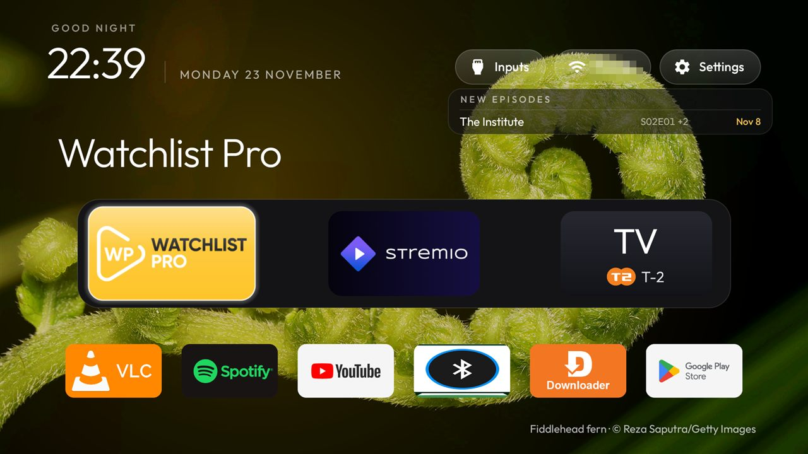

# Daily Wallpaper

Bing's picture of the day as Home's wallpaper, the way Windows shows a new picture every day. This app downloads the
picture, because the launcher has no internet permission; the launcher shows it with `daily_wallpaper` on (in its
`config.xml`, or in a theme). On any other home screen it is an ordinary app that shows today's picture.



## What it does

- Today's picture from Bing's UK edition (`mkt=en-GB`), 1920x1080, with its English caption. Bing changes it at
  midnight UK time.
- On Home the picture is dimmed by 20 to 55 %, more for a bright picture, so the tiles and titles stay readable.
  Its caption is one small line at the bottom right. With `episodes_panel` on, the NEW EPISODES panel gets a dark
  backing, since a bright part of the picture can sit right behind it.
- A new picture fades in over half a second, even while Home is showing; with reduced motion it simply changes.
- The clock screensaver shows the same picture.
- A Wallpaper picked in Launcher settings wins until you pick Theme default again. Before the first download, and
  without this app, Home shows the theme's own wallpaper.
- The app's own screen shows today's picture, its caption, when it last checked and when it checks next, and a
  Refresh button.

## When it checks

When the TV starts, five minutes after midnight UK time, and when Home comes back after a check was missed (the TV
was off). After a failure it keeps the last picture and tries again after 5, 15 and 60 minutes, then every hour,
only while the TV is on. Only today's and the previous picture are kept.

## Install

The launcher reads this app only when both are signed with the same key, so build both on the same computer. Install
this app first, then build and install the launcher with `daily_wallpaper` on.

```bash
cd addons/daily-wallpaper && ./gradlew assembleRelease && cd ../..
TV_HOST=<tv ip> tools/venv/bin/python -I tools/tv.py --push addons/daily-wallpaper/app/build/outputs/apk/release/app-release.apk /data/local/tmp/addon.apk
TV_HOST=<tv ip> tools/venv/bin/python -I tools/tv.py 'pm install -r /data/local/tmp/addon.apk; rm -f /data/local/tmp/addon.apk'
```

## Permissions

| Permission | Why |
|---|---|
| Internet (`INTERNET`) | Bing's picture-of-the-day feed and the picture, both on `www.bing.com`. Nothing else is contacted. |
| Run at startup (`RECEIVE_BOOT_COMPLETED`) | One check after the TV starts, once it has a network. |

The app accepts only `https://www.bing.com/` addresses, no redirects, pictures up to 10 MB and captions up to 200
characters. The launcher gets the picture, its caption and how much to dim it over a content provider that answers
apps signed with the same key (and the ADB shell). No account, analytics, ads or libraries.

Bing's pictures are licensed to Microsoft for showing on Bing; this app is for personal use on your own TV.

Tested on a Sony KD-65XD7505 (Android TV 9).
