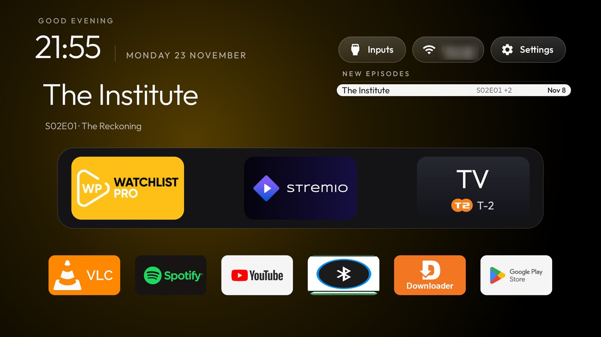

# New Episodes

Fills the launcher's NEW EPISODES panel (`episodes_panel` in the launcher's `config.xml`, or in a theme): the new,
unwatched episodes of the Stremio series you pick, shown on Home above the dock. OK on a row opens that episode in
Stremio. This app does the network work, because the launcher has no internet permission; on any other home screen it
is an ordinary app that lists the same episodes.



## Set up

1. Open **New Episodes** on the TV. It shows a code and a QR code.
2. On your phone or computer, signed in to Stremio, open the link it shows (`link.stremio.com/<code>`) or scan the QR
   code, and approve. The TV signs in by itself within a few seconds.
3. Tick the series to follow. Every series in your Stremio library is listed, and a new one stays off until you
   tick it. Only series with IMDb ids (`tt…`, the ones from Cinemeta) are listed.

## What the panel shows

- One row per series: its first new unwatched episode, `+N` for the other new ones, and the day it came out
  (`today`, `yesterday`, `Fri`, `Nov 12`, or `tomorrow` the day before release). Specials (season 0) are left out.
- An episode shows from the day before its release until it is marked watched in Stremio, for at most 30 days.
  Watched means Stremio's own watched mark, from any device on the account; a half-watched episode still shows.
- Newest first, `tomorrow` last; up to 5 rows, and `+N more` when there are more series.
- Up from the dock enters the rows, Up and Down move between them, Up from the top row goes to the top bar, Down
  from the bottom row goes back to the dock. Down from the top bar enters the top row. A focused row puts the series
  and `S05E03 · Episode name` in the big title.
- Nothing new: the panel hides. Not signed in, or nothing ticked: one `Set up new episodes` row that opens this app.

## Refreshing

The library and its watched marks are read whenever Home comes back, at most every 15 minutes, and once after the
TV starts if Home has not already done it; Cinemeta's episode lists every 6 hours. Without a network (Wi-Fi comes
up after Home when the TV starts) a refresh waits up to two minutes for one; Refresh in this app tries at once. A small loader turns beside the heading when a refresh takes over a
second or a retry is pending. After a failure the last good list stays, and it tries again after 1, 5 and 15 minutes,
then every 30 minutes while the TV is on. After a day without a good refresh the panel says `updated N days ago`.
When Stremio no longer accepts the sign-in, the panel keeps the last list and adds `Sign in to Stremio again`.

## Install

The launcher reads this app only when both are signed with the same key, so build both on the same computer. Install
this app first, then build and install the launcher with `episodes_panel` on.

```bash
cd addons/new-episodes && ./gradlew assembleRelease && cd ../..
TV_HOST=<tv ip> tools/venv/bin/python -I tools/tv.py --push addons/new-episodes/app/build/outputs/apk/release/app-release.apk /data/local/tmp/addon.apk
TV_HOST=<tv ip> tools/venv/bin/python -I tools/tv.py 'pm install -r /data/local/tmp/addon.apk; rm -f /data/local/tmp/addon.apk'
```

## Permissions

| Permission | Why |
|---|---|
| Internet (`INTERNET`) | Stremio's account API (your library and its watched marks), Stremio's link login, and Cinemeta (episode lists and dates). Nothing else is contacted. |
| Run at startup (`RECEIVE_BOOT_COMPLETED`) | One refresh after the TV starts, once it has a network, if Home has not already made one. |

The Stremio sign-in stays in this app's private storage, is never backed up, and never leaves the TV except to
Stremio. The launcher gets only series and episode names, over a content provider that answers apps signed with the
same key (and the ADB shell). Sign out removes the sign-in from the TV and ends the session at Stremio. No
analytics, ads or libraries.

Tested on a Sony KD-65XD7505 (Android TV 9).
